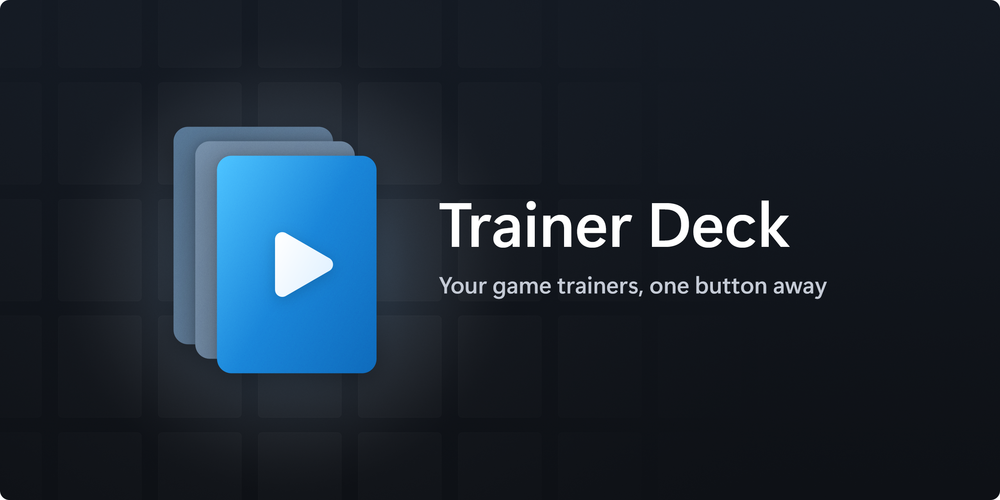
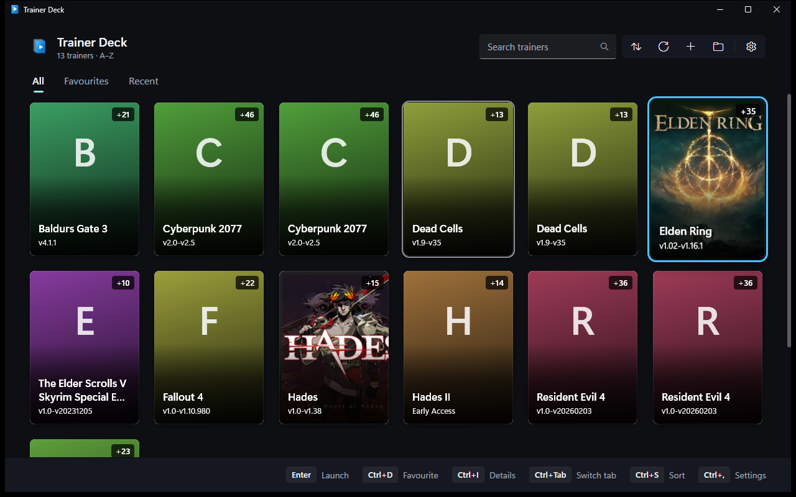
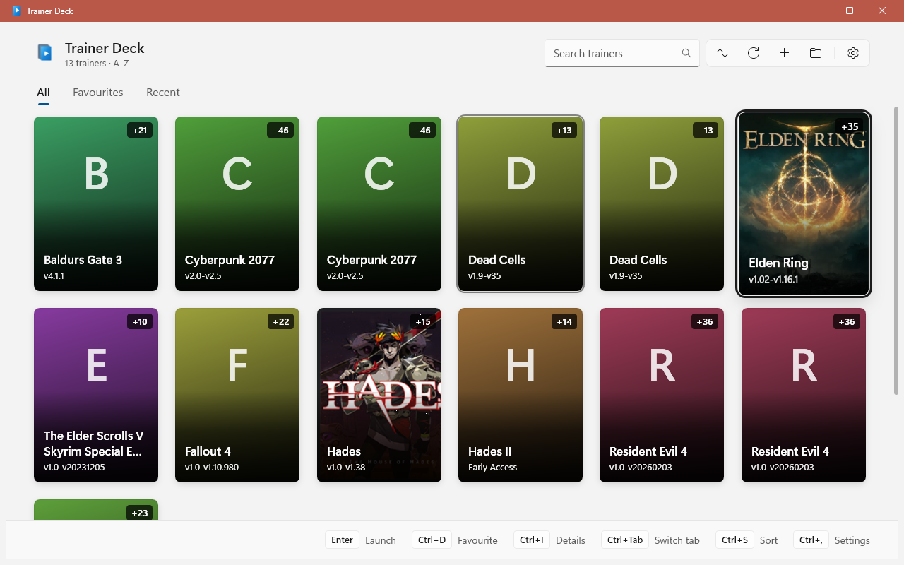
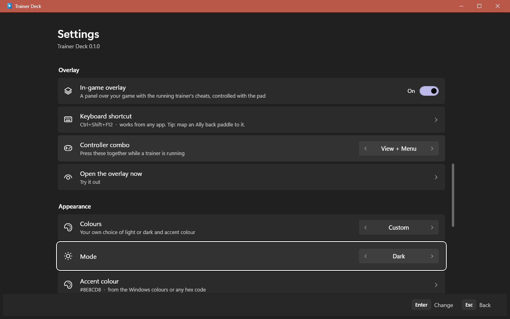
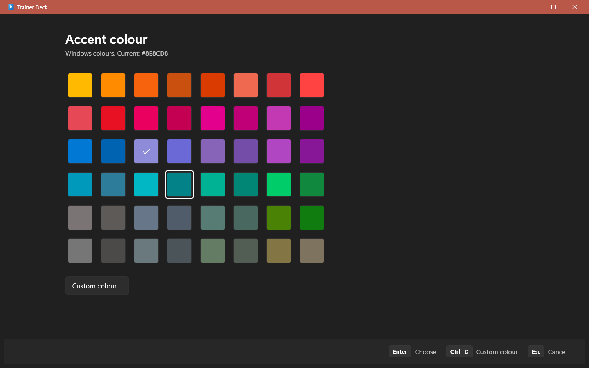

# Trainer Deck

A full-screen, controller-friendly launcher for FLiNG game trainers. It's made for the ROG Ally X in Windows 11's Xbox full-screen experience, and works just as well on a desktop with a mouse and keyboard.



- Scans your trainer folders and turns `ELDEN RING v1.02-v1.16 Plus 35 Trainer.exe` into **Elden Ring**, with **v1.02-v1.16** and **+35** shown on the card.
- Launches trainers as administrator, shows which ones are running, and can close them.
- Navigates fully with a controller (Xbox, the Ally's built-in pad, PlayStation and other DirectInput pads) or with keyboard and mouse.
- Ignores the controller unless Trainer Deck is the window in front, so buttons you press in a game never trigger anything here.
- Shows game cover art: from games installed through Steam (read locally, nothing downloaded), or captured from the trainer's own window the first time it runs. Downloading Steam art for other games is opt-in.
- Looks at home on Windows 11: Fluent controls, Mica, light and dark themes, and your accent colour if you want it.
- Portable: settings and caches live next to the exe.

| Library | Light theme |
| --- | --- |
|  |  |
|  |  |

## Getting started

### Install (recommended)

1. Run `TrainerDeck-vX.Y.Z-setup.exe` and approve the administrator prompt.
2. Keep **Start as administrator without a UAC prompt** ticked and click **Install**. Trainer Deck goes into `C:\Program Files\Trainer Deck`, with a Start menu entry and an entry in **Settings › Apps** to uninstall it.
3. Add trainers with the **+** button (or **Settings › Add a trainer…**). It opens your Downloads folder; pick a trainer `.exe` or `.zip` and it's copied (or extracted) into the Trainers folder.

Running the setup again updates the installed copy in place.

**About the prompt-free start:** trainers need administrator rights, and so does Trainer Deck to read them for the Cheats panel. Normally that means a UAC prompt every time it starts. Instead, the installer (which you approved as administrator) registers a Task Scheduler entry, "Trainer Deck (administrator)", that starts the installed exe with full rights.
- Starting Trainer Deck from the Start menu, the Xbox app or a shortcut runs that entry, with no prompt.
- The entry only starts `TrainerDeck.exe` in Program Files, which only administrators can change.
- The Trainers folder is inside Program Files too, so other programs can't slip an exe in for Trainer Deck to run as administrator.
- Uninstalling removes the entry. Untick the option during setup if you'd rather approve a prompt each time.

### Portable

1. Unzip `TrainerDeck-vX.Y.Z-portable.zip` somewhere, e.g. `D:\Tools\`, and run `Trainer Deck\TrainerDeck.exe`. A `Trainers` folder is created next to it.
2. Put your trainers (or their `.zip` files) in `Trainers`. Subfolders are fine. The library updates by itself.
3. Optional: add more trainer folders in **Settings › Add a trainer folder…**.

### Folder layout

```
Trainer Deck\
├── TrainerDeck.exe
├── Trainers\                 ← default trainer folder (scanned recursively)
│   ├── Elden Ring v1.16 Plus 35 Trainer.exe
│   └── Hades II\
│       └── Hades II Early Access Plus 20 Trainer.exe
├── settings.json             ← settings
├── library.json              ← favourites, renames, hidden, launch history, Steam links
├── art\                      ← images you picked with “Change art”
├── cache\                    ← icon and Steam art cache (safe to delete)
└── trainerdeck.log           ← rolling log (trainerdeck.1.log … .3.log)
```

That's the portable layout. An installed copy keeps `Trainers` in `C:\Program Files\Trainer Deck\Trainers`, and settings, library and caches in `%LOCALAPPDATA%\TrainerDeck`. A portable copy whose folder isn't writable also uses `%LOCALAPPDATA%\TrainerDeck`.

### Antivirus

Trainers modify game memory, so antivirus tools often flag them or quietly delete them. Trainer Deck shows a one-time tip about this. If trainers keep disappearing, add your trainer folder to **Windows Security › Virus & threat protection › Manage settings › Exclusions**. Only do this for trainers from a source you trust. When a trainer goes missing, Trainer Deck tells you it may have been quarantined.

## Controls

| Action | Controller | Keyboard |
|---|---|---|
| Move | D-pad / left stick (holding repeats) | Arrow keys |
| Launch / select (opens Cheats on a running trainer) | A (✕) | Enter |
| Back / clear search | B (○) | Esc |
| Favourite | X (□) | Ctrl+D |
| Details | Y (△) | Ctrl+I |
| Switch tab (All / Favourites / Recent) | Tap LB / RB (L1 / R1) | Ctrl+Tab |
| Jump to a letter (A–Z) | **Hold** LB or RB, pick with the d-pad, release | Just type to search |
| Page up / down | LT / RT (L2 / R2) | PgUp / PgDn |
| Change sort | View (Share) | Ctrl+S |
| Settings | Menu (Options) | Ctrl+, |
| Rescan | Settings › Rescan now | F5 |
| Full screen on/off | | F11 or Alt+Enter |

The footer always shows the buttons for whatever you used last: Xbox, PlayStation, generic pad or keyboard.

With a mouse: double-click a card to launch it, right-click for more options, and use the wheel to scroll.

### Back paddles on the ROG Ally X

The Ally X's back paddles can send keyboard keys, which is handy for trainer hotkeys. Most FLiNG trainers use **Numpad** keys (Numpad 1–9, often with Ctrl/Alt). In **Armoury Crate SE › Control Mode › Gamepad › Edit layout**, map the back buttons to the numpad keys of the cheats you use most, e.g. M1 → Numpad 1 (god mode) and M2 → Numpad 2 (infinite stamina).

## Launching

- **Launch:** trainers start as administrator with their own folder as the working directory. Most trainers need admin rights, so Windows shows a UAC prompt. Cancelling it does nothing.
- **After launch:** by default (**Stay in front**) the trainer opens behind Trainer Deck, so you never have to touch its window. **Settings › After launching a trainer** can instead bring the trainer forward and then minimise, close or hide Trainer Deck to the tray.
- **Running trainers:** a green **Running** badge shows on each one, including trainers you started another way. Press A on a running trainer to open its Cheats page. To end a trainer, click the ✕ next to its **Running** badge, or use **Close trainer** on its Cheats page (also in the overlay and Game Bar widget), details page (Y) or right-click menu.
- **Always run as administrator** (top of Settings; recommended): Trainer Deck asks for admin rights once when it starts, so trainers launch without a prompt each time. This also lets Close trainer work on any trainer. The trade-off is one UAC prompt every time Trainer Deck starts. Steam games are still started without admin rights.

## Card art

FLiNG trainers all share the same "Trainer 3DM" icon, so Trainer Deck doesn't use it. Each card shows, in order of preference:

1. **Your own image:** details page › Change art.
2. **Steam art,** for games installed through Steam (or downloaded, if you turn that on).
3. **The game cover from the trainer's window.** It's captured automatically the first time a trainer is running and Trainer Deck can read it, which needs **Always run as administrator**. It's saved in `cache\covers`.
4. **A coloured tile with the game's initial** until one of the above is available.

The folder button in the top bar opens your trainer folder.

## Cheats panel (controller remote for trainers)

FLiNG trainers expect a keyboard with a numpad. Trainer Deck lets you use them with a controller instead:

- **Opening it:** press **A** on a running trainer, or pick **Cheats** on its details page, to open its cheat list. Each cheat shows its hotkey, its on/off state and its value.
- **A:** turns a cheat on or off, or runs a one-off action such as "Edit Runes".
- **←/→:** adjust multipliers (game speed, damage…).
- **Y:** type a value, or pick from a list (teleport spots, save locations). These lists fill in once the game is running.
- **X:** assign a controller shortcut (see below).

**How it works:**
- **Current FLiNG trainers:** Trainer Deck reads the trainer's window through Windows accessibility (UI Automation) and presses the trainer's own switches. What you see is the trainer's real state, kept in sync even if you also use the keyboard.
- **Older trainers:** for example Hades v1.38, Trainer Deck reads the cheat names and presses their hotkeys for you. It can't see whether a cheat is on, so listen for the trainer's beep.
- **Administrator rights:** trainers run as administrator, and Windows only lets a program read another program's window when it has the same rights. Turn on **Settings › Always run as administrator** to get the full panel (the panel offers a one-click restart). Without it, the panel falls back to pressing hotkeys, using the cheat list from the last time the trainer was read.

### Overlay (in game)

The overlay is a panel over your game with the running trainer's cheats. Navigate it with the pad, and press B to close it and return to the game.

- **Keyboard shortcut:** Ctrl+Shift+F12 by default (Settings › Overlay › Keyboard shortcut to record another). It works from any app, so you can map an Ally X back paddle to it in Armoury Crate.
- **Controller combo:** View + Menu by default; also L3 + R3, LB + RB + View or LB + RB + Menu. It works from any app, with or without a trainer running.
- **Several trainers running:** LB / RB switches between them.
- **Fullscreen games:** use borderless or windowed mode. Exclusive full-screen games minimise when the overlay takes focus.

### Xbox Game Bar widget

The installer can add a **Trainer Deck** widget to Xbox Game Bar (tick **Xbox Game Bar widget** in setup). Portable copies install it from **Settings › Overlay and Game Bar › Xbox Game Bar widget**, which also reinstalls or removes it (it asks for administrator permission once). Press the Xbox button (or **Win + G**), open the widget menu and choose **Trainer Deck**. It shows the running trainer's cheats: **A** toggles or applies one, **d-pad left/right** steps a value. Pin it to keep the list on screen while you play.

The widget is a remote for Trainer Deck, so Trainer Deck has to be running (in a window or in the tray). If it isn't, the widget offers **Open Trainer Deck**.

The widget is signed with Trainer Deck's own certificate rather than a paid one, so setup adds that certificate to the PC's **Trusted People** store; that trusts packages signed with this one certificate and nothing else. Uninstalling Trainer Deck removes the widget and the certificate.

### In-game controller shortcuts

Turn on **Settings › Cheats › In-game controller shortcuts**, then assign shortcuts per cheat with **X** in the Cheats panel. While you play, hold the shortcut button (View by default; LB + RB, a stick click or View + Menu also work) and press the assigned button.

- **Background reading:** Trainer Deck reads the controller in the background only while shortcuts are on *and* a trainer with shortcuts assigned is running. Everything else is still ignored when Trainer Deck isn't in front.
- **The game sees the buttons too.** Pick combinations the game doesn't use at the same time, or a shortcut button the game ignores.

## Running in the tray

**Settings › Window › Close button** decides what closing the window does (its × button, the taskbar's Close window, Alt+F4, or the power button at the top right of the library):
- **Ask every time** (default): choose between the tray and exiting, with **Remember my choice** to stop asking
- **Exit Trainer Deck**
- **Keep running in the tray:** while it's in the tray, the overlay shortcut and the overlay combo keep working, and cheat shortcuts work whenever a trainer is running. Click the tray icon to open the window again, or right-click it to open the overlay or exit.

**After launching a trainer** can also be set to **Hide to tray**.

## Appearance

**Settings › Appearance › Colours** picks the look:
- **Trainer Deck** (default): the original dark theme in Trainer Deck blue.
- **Match Windows:** follows Windows' light or dark mode and your accent colour, and changes as soon as you change them in Windows.
- **Custom:** choose **Dark**, **Light** or **Follow Windows**, and an **Accent colour** from the same 48 colours as Windows (move with the d-pad, A to choose) or any hex code (Y, then type it).

Accent colours are adjusted where needed so text and switches stay readable. In a normal window, Match Windows and Custom use the Windows 11 Mica background (Windows 11 22H2 or later); full screen keeps a solid background.

## Steam

- **Use games installed with Steam** (on by default): Trainer Deck reads your Steam folder to find installed games. A trainer whose name matches an installed game gets that game's library art and a **Play** button on its details page. Nothing is downloaded.
- **Download art from Steam** (off by default): games you don't have installed are looked up on the Steam store and their library art is downloaded into `cache\steam`.
- **Wrong match?** Open the trainer's details and pick **Unlink Steam game**, or rename the trainer to the exact Steam name.

## Adding Trainer Deck to the Xbox app and Armoury Crate

### Xbox app (Xbox full-screen experience)

1. Open the **Xbox** app on the desktop.
2. Go to **My Library**, select the **+** button (Add a game from your PC), and browse to `TrainerDeck.exe`.
3. Trainer Deck now appears in your library and in the full-screen experience. It opens in full screen by default.

### Armoury Crate SE (ROG Ally)

1. Open **Armoury Crate SE › Game Library**.
2. Choose **Add game / Scan** (wording varies by version) and browse to `TrainerDeck.exe`.
3. To give it a cover, use the artwork in [`art/`](art) (see **Artwork** below).

## Building

Requires the **.NET 10 SDK** on Windows. The Game Bar widget also needs **Visual Studio 2022 or later** (Community is fine) with the **Universal Windows Platform development** workload; without it `build.ps1` builds everything else and leaves the widget out of the installer.

```powershell
dotnet build
dotnet test
```

### Publish (portable exe and installer)

```powershell
.\build.ps1
```

This creates, in `publish\`:
- `TrainerDeck-vX.Y.Z-setup.exe`: the installer.
- `Trainer Deck\TrainerDeck.exe`: the portable app in its own folder (its `Trainers` folder and data appear there on first launch).
- `TrainerDeck-vX.Y.Z-portable.zip`: that folder, zipped for sharing.

The installer and the portable exe are the same program; only the name differs (any name containing "setup", in any case, runs the installer). In Rider, the **Build installer & portable** run configuration (in `.run\`) runs `build.ps1`; `-NoWidget` gives a quicker build without the Game Bar widget.

If Visual Studio's UWP tools are installed, `build.ps1` also builds the Game Bar widget, signs it and embeds it in both exes. The first run creates a self-signed **CN=Trainer Deck** signing certificate in `.signing\` (ignored by git). Keep a backup of that folder: widget updates must be signed with the same certificate, and a new one means setup has to replace the trust on each PC.

Both are the same self-contained program (about 70 MB; users don't need .NET installed). A copy whose name contains "Setup", or one started with `--install`, runs the installer instead of the app.

The publish command on its own:

```powershell
dotnet publish src/TrainerDeck -c Release -r win-x64 --self-contained true -p:PublishSingleFile=true -p:PublishReadyToRun=true -p:DebugType=None -o publish
```

### Project layout

```
src/TrainerDeck.Core     no WPF; unit-tested
  Library/   FLiNG name parser, scanner, ignore rules, zip import, library.json store, queries
  Input/     gamepad state, stick digitiser, focus gate, input router, mappings, Sony/HID parsers
  Launch/    launch results and errors, running-trainer registry, startup options
  Cheats/    hotkey parser, cheat model, older-trainer layout reader
  Install/   install layout, Task Scheduler definition, uninstall entry
  Art/       .ico writer (packs art/Icon PNGs into the app icon)
  Widget/    Game Bar widget protocol and package identity
  Theming/   colours, Windows accent palettes, theme resolution and contrast checks
  Steam/     VDF parser, Steam library/manifests, name matching
  Settings/  settings.json, portable paths
src/TrainerDeck          WPF app (MVVM, CommunityToolkit.Mvvm)
  Input/     XInput + raw HID polling, foreground check
  Launch/    ShellExecuteEx runas, process tracking, single instance
  Cheats/    UI Automation sessions with trainers, hotkey sending, cover capture
  Install/   setup window, installer/uninstaller, shortcuts, Game Bar widget install
  Widget/    named pipe server and bridge for the Game Bar widget
  Steam/     Steam location, art cache and downloads, game launching
  Art/       icon extraction, cover/hero loading, colour tools
  UI/        theme (ThemeManager, Fluent styles), views, view models, controls
src/TrainerDeck.Widget   Xbox Game Bar widget (UWP; build with Visual Studio or build.ps1)
tests/TrainerDeck.Tests  xUnit
```

## Troubleshooting

- **A trainer is missing from the library:** check it isn't hidden (**Settings › Hidden trainers**) or filtered out (**Settings › Ignore patterns**). Installers and uninstallers (`unins000.exe`, `*setup*`) are skipped on purpose. Also check that your antivirus didn't remove it.
- **The controller does nothing:** Trainer Deck only reads the controller while its own window is in front and not minimised. Click into it or switch to it first.
- **Double inputs with a PlayStation pad:** Steam's desktop controller layout may be turning the pad into keyboard input. Turn off Steam Input for the desktop layout.
- **Logs:** everything worth knowing goes to `trainerdeck.log` next to the exe.
